# Klasifikasi Penyakit Buah Kakao 

Notebook ini membandingkan 3 arsitektur deep learning seperti **ResNet50-CBAM**, **ResNet50** dan **ResNet152V2** dalam klasifikasi citra buah kakao yang terdiri dari empat kelas, diantaranya adalah:
* Busuk Buah
* Helopeltis
* Kakao Sehat
* Penggerek Buah Kakao

## A) Dataset
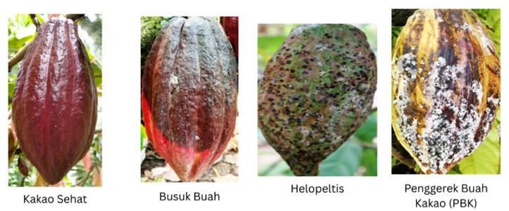

Pengumpulan dataset yang digunakan dalam penelitian ini dilakukan melalui 2 sumber, yakni primer dan sekunder. Untuk dataset primer diperoleh melalui pengamatan langsung di wilayah Kelompok Tani Setya Maju 6 Dusun Gentungan Desa Gawang Kecamatan Kebonagung Kabupaten Pacitan. Sedangkan dataset sekunder diperoleh melalui website roboflow **https://universe.roboflow.com/itera-zghl1/tugas-akhir-hama-penyakit-kakao** dan **https://universe.roboflow.com/tugas-akhir-hama-dan-penyakit-tanaman-kakao/pest-and-disease-of-cocoa-fruit**. Dataset yang bersumber dari primer dan sekunder tersebut kemudian dikumpulkan jadi satu pada drive berikut:
* Dataset Primer: https://drive.google.com/drive/folders/1srUz7IyVELpoHTBoK55maSGIu3Xa4eh-?usp=sharing
* Dataset Sekunder: https://drive.google.com/drive/folders/1dizY2Vr7csJY_Rw7S49-uYEqoZ9xUkrh?usp=sharing
* Dataset Primer & Sekunder: https://drive.google.com/drive/folders/1pu14ZP61CkWM9kihtMSIkMEY9Hyv2hL9?usp=sharing

Total Dataset Primer & Sekunder berjumlah **6.992 citra** dengan masing-masing kelas citra: 

| Kelas | Jumlah Citra |
| ----- | ------------ |
| Busuk Buah| 1.748| 
| Helopeltis| 1.748|
| Kakao Sehat| 1.748|
| Penggerek Buah Kakao| 1.748|

## B. Pre-Processing Data

Tahapan pre-processing data yang dilakukan meliputi:
*  mengubah gambar menjadi tensor number (array), dengan format warna RGB (Red, Green, Blue) dan tensor 3 Dimensi dengan struktur [tinggi, lebar, saluran warna).
* mengubah ukuran menjadi 224x224 piksel agar sesuai dengan ukuran input model deep learning.
* mengubah tipe data cast dari tensor number (array) ke float32 agar memudahkan dalam proses normalisasi.
* menerapkan augmentasi data, dengan kondisi dimana dataset tersebut merupakan data training. jadi, yang di augmentasi merupakan data training. augmentasi data diperlukan untuk mencegah overfitting dan meningkatkan kemampuan generalisasi model deep learning.
* melakukan normalisasi piksel spesifik sesuai ukuran arsitektur model resnet50 atau resnet152v2.
* mengubah label angka kelas menjadi format One-Hot Encoding [0, 1, 2, 3] agar menghindari asumsi "Urutan Nilai" (ordinal bias) pada model deep learning.

## C. Pembagian Dataset

Dataset kemudian dibagi dengan menggunakan proporsi **80% Training**, **10% validation** dan **10% testing**. Adapun rinciannya sebagai berikut:

|Dataset | Jumlah Citra |
|------- | ------------ |
| Training| 5.593| 
| Validation| 699|
| Testing| 700|

## D. Model

Dalam penelitian ini, 3 model yang digunakan sebagai perbandingan, diantaranya adalah **ResNet50**, **ResNet152V2** dan **ResNet50-CBAM**. Adapun rinciannya sebagai berikut:

|Model | Menggunakan Pre-trained ImageNet| Classifier|
|----- | ------------------------------- |---------|
| **ResNet50**| Ya| GlobalAveragePooling2D, Dense(256, activation="relu"), Dropout(0.5), Dense(4, Softmax)|
| **ResNet152V2**| Ya| GlobalAveragePooling2D, Dense(256, activation="relu"), Dropout(0.5), Dense(4, Softmax)|
| **ResNet50-CBAM**| Ya| GlobalAveragePooling2D, Dense(256, activation="relu"), Dropout(0.5), Dense(4, Softmax)|

## E. Tahapan Training Model

Terdapat 2 tahapan dalam melakukan training model, diantaranya adalah:
* **Tahapan 1** : membekukan (freeze) backbone agar bobot dari pretrained ImageNet ResNet tidak diperbarui selama proses pelatihan (training) model berlangsung. Dalam skenario transfer learning, model sudah memiliki pengetahuan visual dari data ImageNet. Pada tahap awal, bertujuan untuk mempertahankan pengetahuan tersebut sambil melatih classifier agar menyesuaikan diri dengan citra penyakit buah kakao. Contohnya, saat model mempelajari empat kelas buah kakao, proses pelatihan model dapat diarahkan untuk mempelajari classifier terlebih dahulu tanpa mengubah bobot konvolusi dari pretrained ImageNet.
* **Tahapan 2** : membuka sebagian layer backbone agar bobotnya dapat diperbarui kembali dengan menggunakan dataset buah kakao. Disini, stage yang akan dibuka adalah **conv3_x**, **conv4_x** dan **conv5_x**. Sementara itu, **conv2_x** dan bagian awal dari ResNet tetap akan dibekukan (freeze). Dan juga, semua layer dari BatchNormalization juga dipertahankan dalam keadaan tidak trainable.

## F. Konfigurasi Training

Adapun konfigurasi yang digunakan dalam tahapan training model diantaranya sebagai berikut:

|Jenis Parameter | Nilai Parameter|
|----------------| -------------- |
| Optimizer| Adam|
| Learning Rate (Tahap 1) | 1e-4| 
| Learning Rate (Tahap 2) | 5e-6|
| Epochs (tahap 1)        | 30  |
| Epochs (tahap 2)        | 40  |
| Batch Size              | 32  |
| Loss                    | Categorical Crossentropy|
| Metrics                 | Accuracy|
| Callback                | **ModelCheckpoint**(checkpoint_path, monitor="val_loss", save_best_only=True, mode="min", verbose=1),**EarlyStopping**(monitor="val_loss", mode="min", patience=7, restore_best_weights=True, verbose=1),**ReduceLROnPlateau**(monitor="val_loss",mode="min",factor=0.5, patience=2, min_lr=1e-7,verbose=1)

## G. Hasil Evaluasi Model

Adapun hasil evaluasi model yang telah dilakukan sebagai berikut:

1. Model ResNet50
* History Plot Training Model ResNet50 (**Tahap 1**)
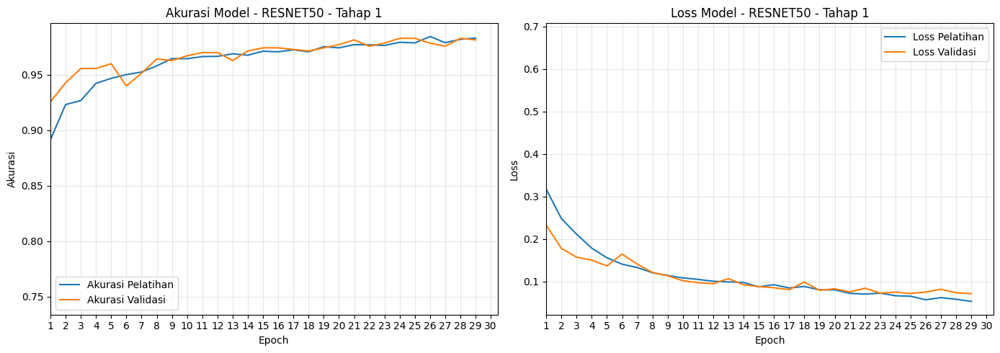

* Hasil Evaluasi Model ResNet50 (**Tahap 1**)
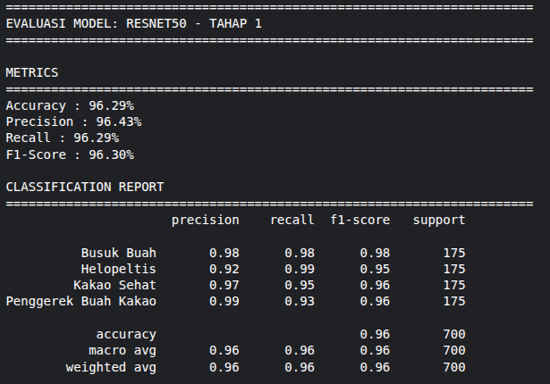
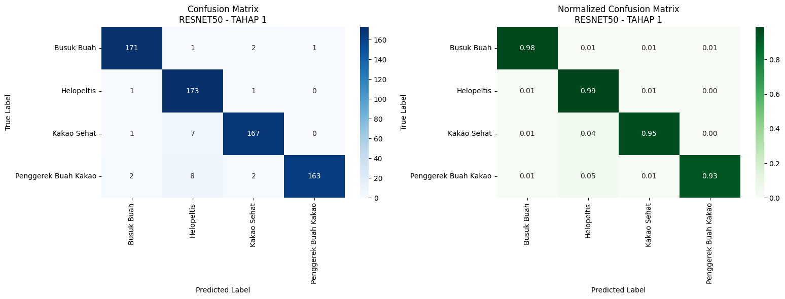

* History Plot Training Model ResNet50 (**Tahap 2**)
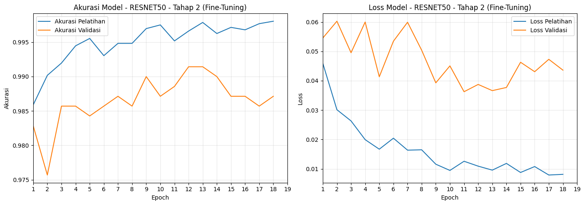

* Hasil Evaluasi Model ResNet50 (**Tahap 2**)
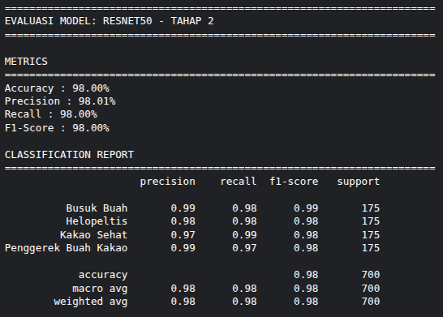
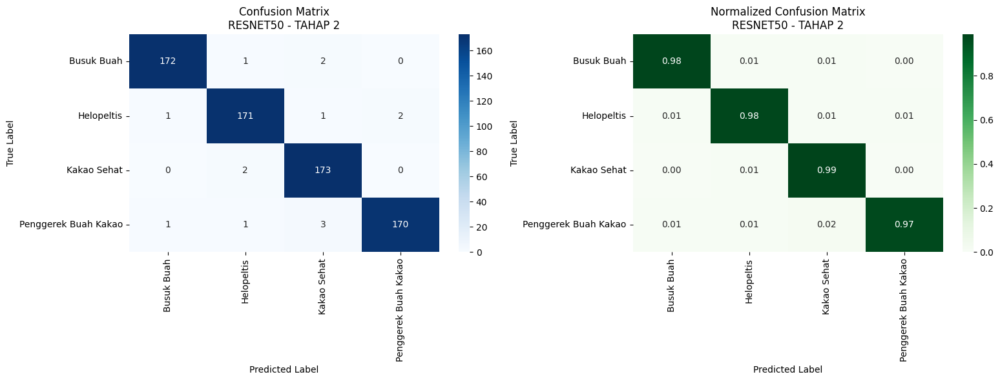

2. Model ResNet152V2

* History Plot Training Model ResNet152V2 (**Tahap 1**)
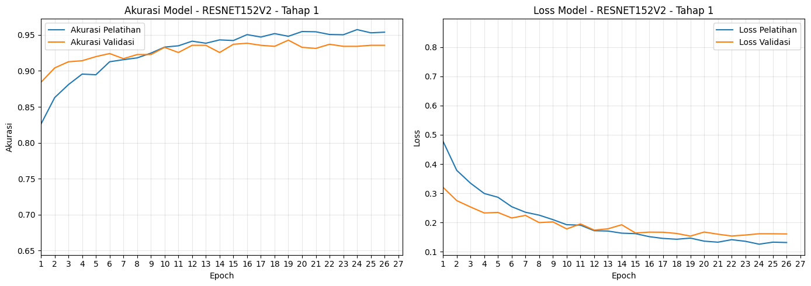

* Hasil Evaluasi Model ResNet152V2 (**Tahap 1**)
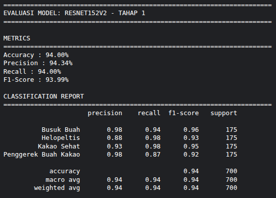
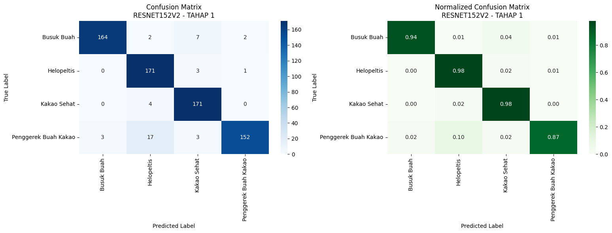

* History Plot Training Model ResNet152V2 (**Tahap 2**)
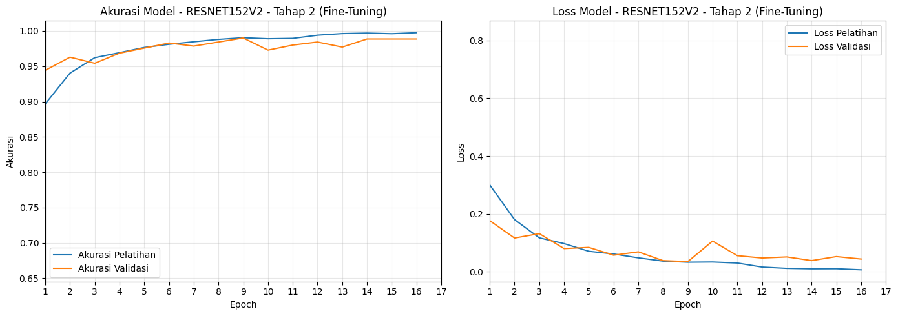

* Hasil Evaluasi Model ResNet152V2 (**Tahap 2**)
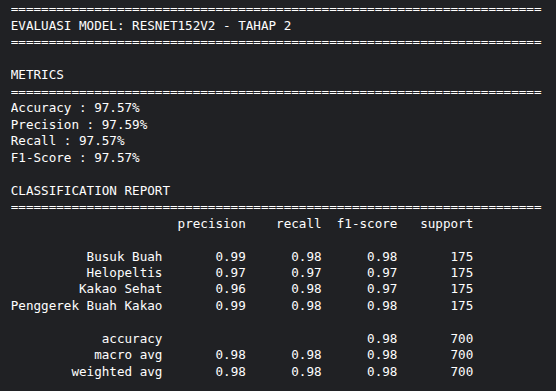

3. Model ResNet50-CBAM

* History Plot Training Model ResNet50-CBAM (**Tahap 1**)
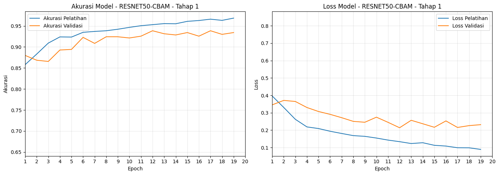

* Hasil Evaluasi Model ResNet50-CBAM (**Tahap 1**)
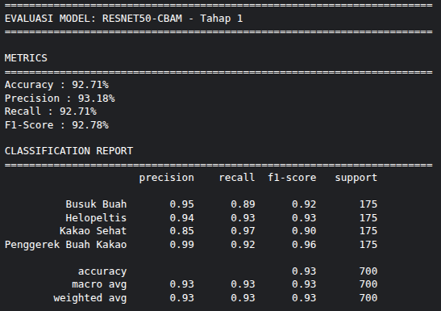
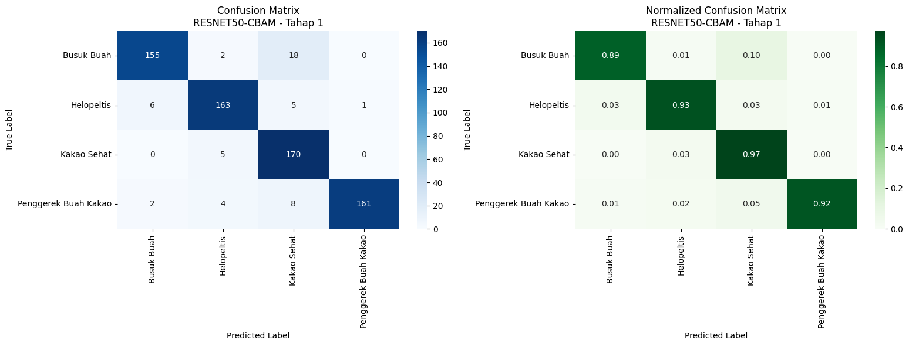

* History Plot Training Model ResNet50-CBAM (**Tahap 2**)
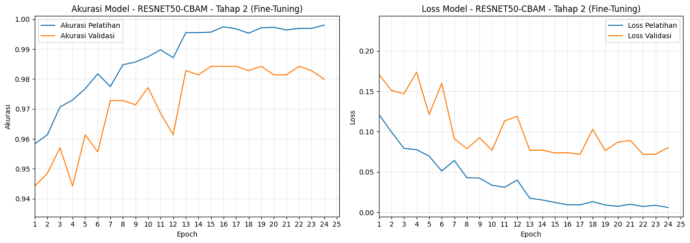

* Hasil Evaluasi Model ResNet50-CBAM (**Tahap 2**)
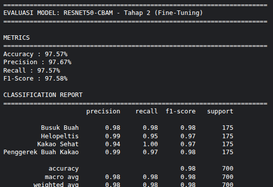

## H. Perbandingan Hasil Evaluasi Model

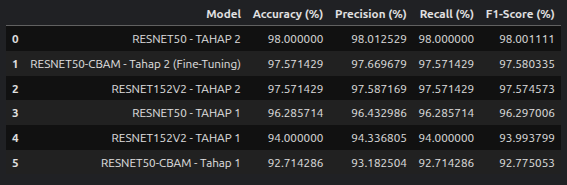
